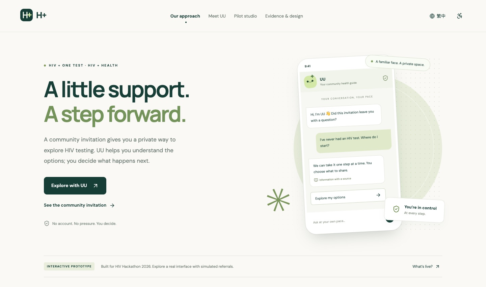
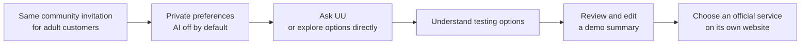
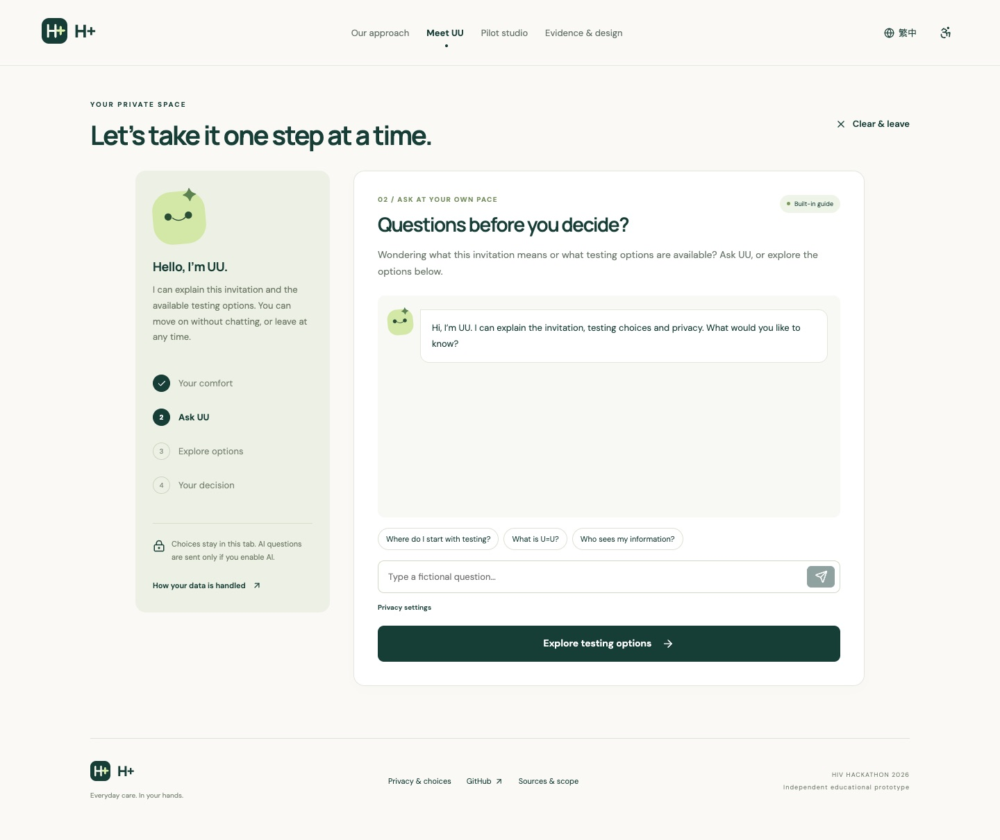
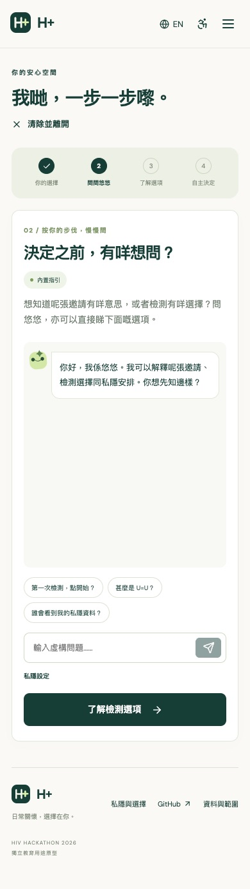
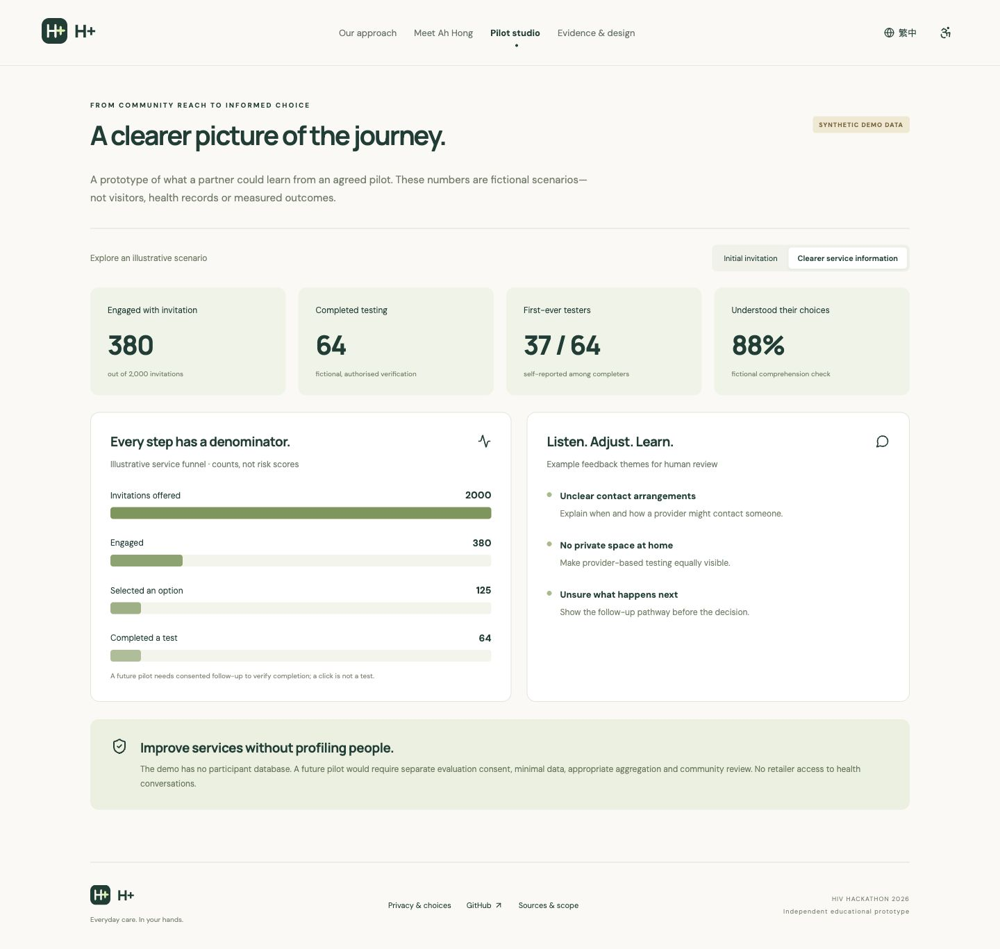
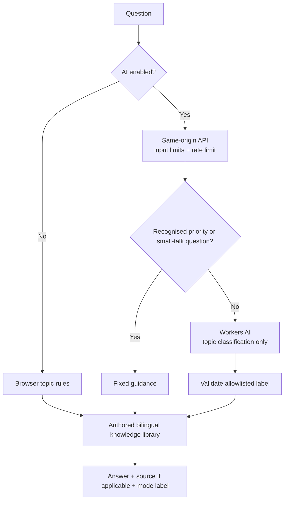

<div align="center">
  
  <h1>H+</h1>
  <p><strong>A little support. A step forward.</strong></p>
  <p>HIV plus one test · HIV plus Health · Private conversations</p>
  <p>
    <a href="https://h-plus.stephenovo.workers.dev"><strong>Explore the live demo ↗</strong></a>
    · <a href="README.zh-Hant.md">繁體中文</a>
    · <a href="docs/DEMO_GUIDE.md">90-second walkthrough</a>
    · <a href="docs/ARCHITECTURE.md">Architecture</a>
  </p>
  <p>
    
    
    
    
    
    
  </p>
</div>

<p align="center"></p>

## Why H+

**H+ means HIV plus one test and HIV plus Health.** UU (悠悠) is the guide who helps visitors explore the invitation and their testing choices.

An everyday pharmacy visit can be an opportunity to learn about HIV testing—without a shopping profile, an individual risk label, or pressure to participate.

H+ is an **independent educational prototype for HIV Hackathon 2026**. It explores how a familiar community invitation can lead to a private conversation, understandable testing options and a next step chosen by the user. The proposed pilot initially focuses on adults aged 50+ and first-time testers; this website demonstrates the experience, not measured clinical outcomes.

> **Our question:** can a familiar community touchpoint help people who have never tested take an informed first step?

Hong Kong CHP reported that around half of newly reported cases were late presenters, and nearly 80% of late presenters had never previously tested. See the [August 2026 announcement](https://www.info.gov.hk/gia/general/202608/25/P2026082500601p.htm). These are population-level observations, not a basis for inferring an individual shopper’s HIV status.

## Try it in 90 seconds

1. Open the [live experience](https://h-plus.stephenovo.workers.dev) and view the community invitation.
2. Meet **UU (悠悠)**. Choose English or Traditional Chinese, larger text, and whether to enable AI.
3. Ask “What is U=U?” or “Who sees my information?” Every answer identifies its source or explains this prototype’s own behaviour.
4. Explore self-testing and provider-based testing directly; chatting is optional.
5. Edit the sample summary, remove a field, and explicitly confirm the demo plan.
6. Open [Pilot studio](https://h-plus.stephenovo.workers.dev/#impact) to explore **clearly labelled synthetic scenarios**.

Use fictional questions only. No booking, kit dispatch or real referral occurs.

## The product loop



## What is implemented

| Surface | Working capability |
| --- | --- |
| **Community invitation** | Printable receipt-style invitation with a QR code to the live journey |
| **Private preferences** | English / Traditional Chinese, larger text, optional AI, clear-session control |
| **UU conversation** | Live Workers AI topic matching; prepared replies with sources for health information; built-in guidance without AI |
| **Priority guidance** | Deterministic routing for recognised recent-exposure and reactive-result questions |
| **U=U education** | Accurate sexual-transmission scope; treatment and sustained viral-load follow-up conditions |
| **Service choices** | Self-testing and provider-based options, official links, no artificial age-based restriction |
| **Consent preview** | Editable fields, optional note, explicit confirmation, downloadable demo plan |
| **Pilot studio** | Two synthetic scenarios, denominators, illustrative feedback themes; no participant database |
| **Evidence page** | Sources and an explicit distinction between implemented functionality and proposed integrations |

### A calm experience, on desktop and phone

<p align="center"></p>

<details>
  <summary><strong>See the Traditional Chinese mobile experience</strong></summary>
  <p align="center"></p>
</details>

<details>
  <summary><strong>See the illustrative pilot studio</strong></summary>
  <p align="center"></p>
</details>

## AI with a deliberately bounded job

The live model is **Llama 3.1 8B Instruct Fast on Cloudflare Workers AI**. It classifies a question into a small allowlist of topics; it does not generate medical advice shown to the user. The server then returns the corresponding authored answer and a source for health information. Greetings, thanks, identity and weather questions receive brief prepared conversational replies. The weather reply links to the Hong Kong Observatory rather than inventing a live forecast.



If the model is unavailable, the UI explicitly labels the built-in fallback. Recognised urgent, reactive-result, everyday-contact and small-talk questions bypass the model. Output is rendered as text, not model-generated HTML. These boundaries reduce the model’s role; they do **not** establish clinical validation or guarantee that every wording is correctly understood.

## Privacy by implementation

- No application account, cookies, analytics SDK, local storage, database, or saved chat history.
- Choices and messages remain in the current tab’s React state. Refreshing or clearing the session removes that state.
- AI is optional and off by default. When enabled, the current question—not the entire chat—is sent to the Worker and Workers AI.
- The application does not log message bodies. Cloudflare still processes request/inference data and technical metadata under its policies; rate limiting uses the connecting IP.
- No retailer or clinic receives conversations, results or demo summaries.
- Fonts are self-hosted. External service links open only when selected.
- Browser history, downloads, printouts and device speech services are outside the clear-session control. Optional read-aloud uses the browser/OS speech implementation.

See [privacy and pilot readiness](docs/PRIVACY_AND_SAFETY.md).

## Quick start

Requirements: Node.js 22+, npm, and a modern browser.

```bash
git clone https://github.com/stephenovo/H-plus.git
cd H+
npm ci
npm run dev
```

Open `http://127.0.0.1:4173`. The Vite development server runs the frontend; built-in guidance works immediately. AI requests fall back explicitly because Vite does not run the Worker API.

To run the Worker and assets together:

```bash
npm run build
npx wrangler dev
```

Workers AI requires your Cloudflare account and can incur inference usage even during development. The hosted demo already has its AI binding configured; visitors do not need an API key.

## Verification

```bash
npm test        # 14 focused rule, consent, API and fallback checks
npm run build   # TypeScript + production bundle
npm run check   # both
```

The tests cover consent rejection, same-origin enforcement, oversized input, rate limits, unsafe model prose, bilingual content, priority routing and explicit fallback. GitHub Actions runs them and the production build on pushes and pull requests.

The deployed interface was also checked at **1440 px desktop and 390 px mobile**: English and Traditional Chinese navigation, live AI replies, direct access to testing options, choice gating, removing summary fields, confirmation, session clearing, modal dismissal and synthetic-scenario switching. See [verification notes](docs/VERIFICATION.md). Screenshots are captured from the running app, not design mockups.

## Repository map

```text
H-plus/
├── src/
│   ├── App.tsx               # Bilingual journey, homepage, studio and evidence
│   ├── knowledge.mjs         # Authored answers, sources and browser rules
│   ├── style.css             # Responsive visual system and print styling
│   └── main.tsx              # React entry and self-hosted fonts
├── worker/index.mjs          # Consent-gated, rate-limited AI topic endpoint
├── tests/core.test.mjs       # Rule and Worker contract tests
├── public/                  # Brand mark, social image and security headers
├── docs/                    # Architecture, demo script, privacy and screenshots
├── .github/workflows/ci.yml  # Automated checks
└── wrangler.jsonc            # Standalone Cloudflare Worker deployment
```

## Deployment

The earlier demo address redirects to this deployment. The `legacy-redirect/` Worker preserves links that were shared before the rename.


```bash
npx wrangler login
npm run deploy
```

The configuration creates/updates the `h-plus` Worker in the authenticated Cloudflare account. Choose a different Worker name if deploying a separate copy. It binds Workers AI and a **10 requests / 60 seconds per-IP** limiter. There is no database to migrate and no model secret in browser code. A same-origin check is not authentication; stronger abuse controls and budget monitoring are needed for a wider public launch.

## Prototype scope and next steps

**Live:** the website, bilingual journeys, source-based guidance, Workers AI classification, editable plan, QR invitation and illustrative studio.

**Simulated:** referrals, clinical completion, participant feedback and studio counts.

**Proposed:** WhatsApp Business integration, pharmacy/POS deployment, partner-operated testing and kit distribution, approved evaluation, and a community/clinical review of the workflow.

No partnership with DH, a DHC, NGO or pharmacy is implied. The product does not diagnose HIV, infer risk from purchases, establish U=U status, guarantee appointments or claim improved health outcomes.

The next meaningful milestone is a small, partner-approved usability study, followed by a consented service pilot. The key question is whether first-time testers can understand their choices and connect with an appropriate service.

## Project notes

- [Architecture](docs/ARCHITECTURE.md)
- [Privacy and safety](docs/PRIVACY_AND_SAFETY.md)
- [90-second demonstration and judge questions](docs/DEMO_GUIDE.md)
- [Verification record](docs/VERIFICATION.md)
- [Proposal link wording](docs/SUBMISSION_LINKS.md)

## License

Code is released under the [MIT License](LICENSE). Third-party packages and fonts retain their own licences; linked public-health materials remain the property of their respective publishers.

---

<div align="center"><strong>Everyday care. Your pace. Your choice.</strong></div>
