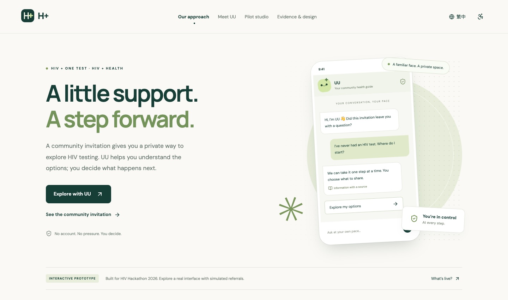
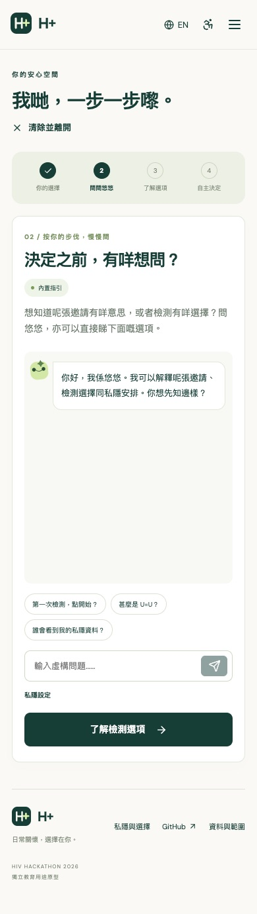

<div align="center">
  
  <h1>H+ 街坊健康</h1>
  <p><strong>多一點支持，安心踏出一步。</strong></p>
  <p>HIV plus one test · HIV plus Health · 私密對話</p>
  <p><a href="https://h-plus.stephenovo.workers.dev"><strong>開啟互動演示 ↗</strong></a> · <a href="README.md">English</a> · <a href="docs/DEMO_GUIDE.md">90 秒演示指南</a></p>
</div>

<p align="center"></p>

## 名稱與理念

**H+ 代表 HIV plus one test、HIV plus Health。**「悠悠」（UU）陪伴使用者了解邀請及檢測選擇。

## 我們想解決甚麼問題

一次日常藥房接觸，可以成為了解 HIV 檢測的機會。每位成年顧客收到相同邀請，無需根據購物資料被判斷風險。

H+ 是為 **HIV Hackathon 2026** 製作的獨立教育用途原型。它把社區邀請、AI 輔助資訊、檢測選擇和知情確認串連起來，讓使用者自主決定下一步。擬議試點聚焦 50 歲以上及首次檢測者；網站並不代表已有臨床成效。

## 可以立即體驗的功能

| 功能 | 內容 |
| --- | --- |
| 社區邀請 | 可列印的收據式邀請，QR 碼直接開啟體驗 |
| 私隱偏好 | 中英文、放大字體、自選 AI、清除對話 |
| 悠悠（UU） | 真實 Workers AI 主題辨識，配合固定、有來源的答案 |
| U=U | 解釋持續治療、病毒載量及性傳播的適用範圍 |
| 檢測導航 | 自我檢測與到場服務，連結官方資料 |
| 自主確認 | 可移除欄位、編輯問題、確認及下載演示計劃 |
| 試點工作室 | 清楚標示為合成資料的示範流程及回饋主題 |

## AI 如何運作

AI 預設關閉。啟用後，每條問題會傳到 Cloudflare Workers AI，由 Llama 3.1 8B Instruct Fast 辨識主題。伺服器只接受指定主題標籤，再回傳已撰寫的中英文內容及來源。

模型不直接生成展示給使用者的醫療建議。已辨識的近期暴露及自測有反應問題，優先使用固定規則。模型無法使用時，介面會明確顯示改用內置指引。這些設計不等同於臨床驗證，也不保證所有表達都能被正確理解。

## 私隱與真實範圍

- 不設帳戶、應用程式資料庫、分析追蹤或瀏覽器持久儲存。
- 對話只保留於當前分頁記憶體；重新整理或清除即移除。
- 使用 AI 才傳送當前問題，不傳送整段對話。
- 程式不記錄對話內容；Cloudflare 仍按其政策處理請求與技術資料，限流使用連線 IP。
- 不向診所或零售商發送資料。轉介、預約、試點數字均為演示。
- 已下載檔案、列印、瀏覽記錄及裝置朗讀服務不受清除按鈕控制。

網站可操作、AI 已接通，但 WhatsApp、POS、物流及真實機構轉介尚未接入。沒有聲稱與衞生署、DHC、NGO 或藥房建立合作。

## 90 秒演示

1. 展示首頁的社區邀請與 QR 碼。
2. 進入悠悠的對話，切換繁體中文，查看 AI 的自選同意。
3. 問「甚麼是 U=U？」並展示資料來源。
4. 不經聊天，直接了解並選擇檢測方式。
5. 移除摘要中的一項資料，閱讀後確認演示計劃。
6. 展示試點工作室，明確說明數據是虛構示例。

<p align="center"></p>

## 本機開發

需要 Node.js 22+ 及 npm。

```bash
git clone https://github.com/stephenovo/H-plus.git
cd H+
npm ci
npm run dev
```

開啟 `http://127.0.0.1:4173`。Vite 只提供前端，內置指引可用；AI 會明確回退。需要完整 Worker 時：

```bash
npm run build
npx wrangler dev
```

Workers AI 需要 Cloudflare 帳戶，開發時的推理亦可能產生用量。

```bash
npm run check   # 14 項自動化測試、型別檢查及建置
npm run deploy  # 發佈至已登入的 Cloudflare 帳戶
```

已檢查桌面與 390 px 手機流程、語言切換、真實 AI、取消分享欄位、確認門檻和合成情境切換。詳細範圍見 [驗證記錄](docs/VERIFICATION.md)。

## 下一步

與社區成員、臨床顧問和服務機構共同審閱內容，確認服務與費用，再進行小規模可用性測試。真實試點須另外處理同意、資料治理、機構容量與成果核實。

程式採用 [MIT License](LICENSE)。
